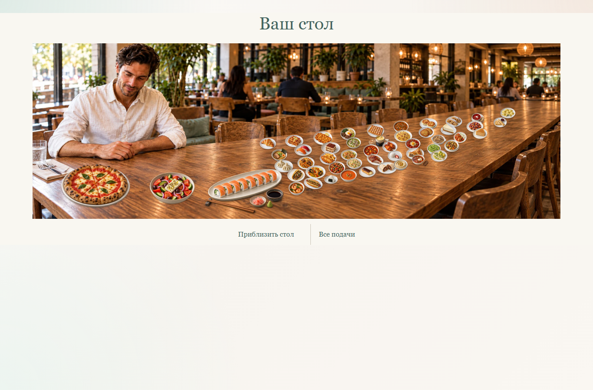

# Ресторанный стол: проверка 12.10.2026

Это техническая и визуальная проверка новой сцены итогов, а не приёмка содержания преподавателем или репетиция в сети колледжа. Использованы только изолированные синтетические результаты; в production технические участники не создавались.

## Оформление и соответствие выбранному ракурсу

| Критерий | Проверенный результат |
|---|---|
| Камера и ресторан | Принятый пользователем близкий ресторанный ракурс, тот же герой, деревянный стол и дневной свет слева. Для большого числа подач — продолжение длинного стола, а не карточки или страницы коллекции. |
| Подачи и масштаб | Пицца нарезана на восемь частей; греческий салат содержит заявленные продукты; восемь роллов с наружным лососем, соевым соусом, имбирём и васаби, без кунжута. Еда перед гостем, пропорции фотографий сохранены. Остальные позиции — существующие дегустационные подачи. |
| Текст и управление | Georgia и тёмно-зелёные надписи сохранены. Названия, кнопки, список и сведения остаются HTML. Изображения не содержат интерфейс или выдуманные баллы. |
| Украшения | По последнему указанию владельца все флажки и шпажки удалены с подач. Еда, посуда и тени остаются основой сцены. |
| Телефон и большая коллекция | На телефоне включено приближение; стол прокручивается внутри сцены. Общий вид содержит все блюда сразу; 51 дегустационная порция меньше, чем восемь блюд на принятом концепте, и доступна через приближение и подробную фотографию. Поиск остаётся доступен. |

Принятый концепт — фотографический ориентир; его восемь заранее изображённых блюд не подменяют персональный результат. Реестр источников, точных промптов, оригиналов и экспортов: [restaurant-live-table-assets.json](restaurant-live-table-assets.json). Использован встроенный ImageGen; экспорт сохраняет пропорции и прозрачность. Общий размер пяти новых изображений — 943 930 байт. Первый вариант со скатертью отвергнут пользователем и не выпускается.

## Функциональные проверки

- `npm.cmd test`: 291 успешный теста; `npm.cmd run build:cloudflare`: успешно.
- Полный браузерный маршрут: 36 сохранённых ответов, 150 баллов, 51 подача после публикации; девять ширин глав, 32 фотографии Т4, сенсорная карта, автоматический фокус Т3, повторная отправка, восстановление режима, потеря связи и ошибки изображений/оформления.
- Таблица: 0, 1, 3, 8, 18 и 51 подача при ширинах 1366/768/390/320; все изображения загрузились, нет переполнения страницы. Отдельно все размеры коллекции 0–51: каждый центр блюда доступен для выбора. Семь ширин 1536/1366/768/430/390/360/320, выбор мышью и Enter, приближение/общий вид, безопасный отказ фона; нет ошибок JavaScript.
- Исправлена воспроизведённая потеря открытого разбора и приближения при фоновой синхронизации. Новые браузерные проверки подтверждают сохранение этих состояний; изменение аварийного отключения оформления всё ещё применяется.
- Экспериментальная серверная разметка флагов удалена. Логика выдачи вариантов и итоговой коллекции совпадает с production до этой визуальной работы. Составы, баллы, сроки и рейтинг не пересчитываются.
- Свидетельство владельца остаётся доступным сразу после личного финиша: баллы из 150, № 199 / 05.10.2026. Правильные ответы не раскрываются. Большой стол ждёт публикации организатора.
- Полный локальный сервер: `npm.cmd run verify:pm01 -- http://127.0.0.1:3228` успешно. Браузерный плагин отсутствует, использованы существующий Playwright и встроенный браузер Codex.

## Репетиция Cloudflare

Предыдущие проверки этой рабочей ветки прошли на 50 участников: p95 742, 759 и 800 мс; без потери/дублирования ответов. На 60 участниках возникали не-JSON 503 и транспортный `fetch failed`; другой свежий deployment вернул HTML «Deployment Not Found» 404 после первоначальной готовности. Это не успешная приёмка на 60, точная причина ранних 503 не установлена.

Теперь адрес постоянной тестовой ветки сверяется с загруженным preview через Cloudflare API, перед измерением требуются четыре последовательных ответа на пустой старт и точное совпадение клиентского файла. Измеряемые запросы не повторяются для скрытия ошибок. Диагностика сохраняет тело ошибки/CF-Ray без учётных данных запросов. Используются только отдельная тестовая D1 и синтетические участники.

Новая репетиция после удаления флагов, выпуск и проверка production фиксируются по окончании workflow. Понятность для студентов и работа реальных устройств колледжа требуют отдельной репетиции.
