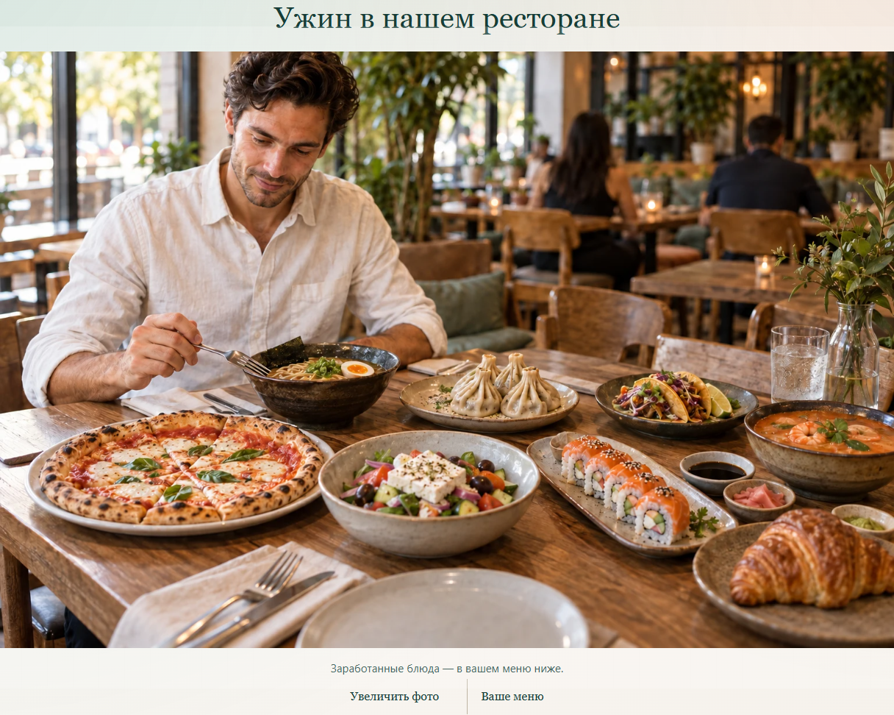
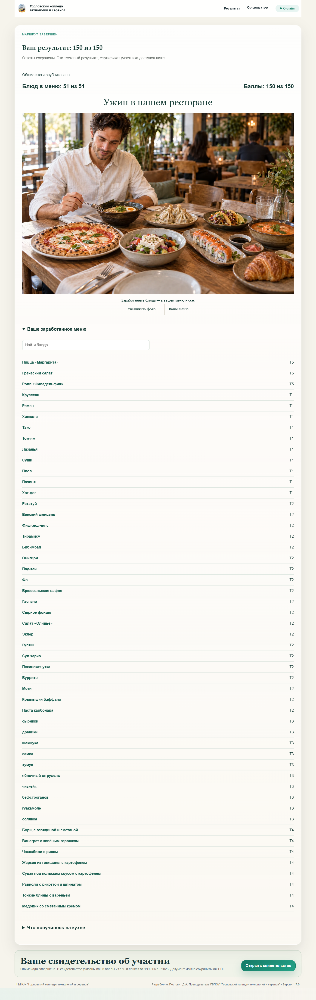

# Финальная сцена ужина: проверка 12.10.2026

Пользователь явно выбрал присланную цельную фотографию, попросил убрать флажки и согласился показать персональный список заработанных блюд под ней. Это заменяет прежнее требование размещать только заработанные блюда прямо на фотографии стола. Сцена — иллюстрация истории; результат определяется исключительно сохранёнными ответами.

## Соответствие выбранному варианту

| Критерий | Результат |
|---|---|
| Композиция | Цельный кадр: тот же гость с вилкой над раменом, ресторан, стол, блюда перед гостем и исходный ракурс. Нет наклеенных подач, сетки или пустого столешничного макета. |
| Флажки | Все флажки и шпажки удалены встроенным ImageGen. Новых аксессуаров не добавлено. |
| Свет и еда | Сохранены естественный масштаб, положение еды, посуда, контактные тени и свет слева. Это декоративный ужин, а не изображение конкретного выданного рецепта. |
| Управление | Фото показано целиком; отдельная кнопка увеличения. Текст и кнопки остаются HTML. Персональное меню открыто, есть поиск и подробности каждого заработанного блюда. |
| Телефон | Кадр сохраняет пропорции и целиком входит в ширину; приближение включается явно. Нет переполнения страницы и обязательных промежуточных экранов. |

[Реестр оригиналов, точного промпта, источника и экспорта](restaurant-live-table-assets.json). Оригинал сохранён локально. Один WebP 1536×1024, 282 590 байт; пропорциональная конвертация без обрезки/увеличения. Прежние прототипы с подставленными блюдами и флажками не выпускаются.

## Техническая проверка

- 291 тест проходит; Cloudflare build проходит. Сервер выдачи вариантов и итоговой коллекции идентичен production baseline.
- Полный браузерный маршрут: 36 сохранённых заданий /150 баллов /51 ссылка заработанного меню. Девять ширин глав, все 32 фото Т4, сенсорная карта Т2, автоматический фокус Т3, повторная отправка, перезагрузка/режим, потеря связи и ошибки картинок/декора.
- Новая сцена: меню из 0/1/8/18/51 блюда; девять ширин 320–1536. Во всех случаях одна и та же цельная фотография и верное число заработанных позиций. Флажков и узлов наклеенных блюд нет. Увеличение, переход к поиску, возврат фокуса из подробностей и отказ фотографии проверены; ноль ошибок JavaScript/переполнения.
- Фоновая синхронизация сохраняет открытый разбор и увеличение. При отключении декора остаются личное меню и свидетельство.
- Свидетельство владельца доступно сразу после личного завершения: баллы из 150, № 199 / 05.10.2026. Сцена и меню доступны после публикации организатора. Правильные ответы не раскрываются.
- Полный локальный PM01 verifier проходит на изолированном стенде. Браузерный плагин отсутствует: использованы существующий Playwright и встроенный браузер Codex. Production участников для проверки не создавали.

## Cloudflare preview

Ранее 50 участников прошли на preview с p95 742/759/800 мс; 60-пользовательские проверки остановились на не-JSON503/транспортном сбое. Другой свежий URL вернул Cloudflare Deployment Not Found404 после начальной готовности. Постоянный alias затем получил HTML502 Cloudflare. Эти проверки не объявляются успешными на 60; причина ранних 503 не установлена.

Для новой проверки alias сверяется с загруженным deployment через API, нужны четыре последовательных ответа пустого старта и совпадение файла клиента. Измеряемые запросы не повторяются для сокрытия ошибок. Диагностика сохраняет HTTP/CF-Ray/тело/cause без учётных данных. Используется отдельная тестовая D1. Альтернативный стандартный ARM runner проверяет другую сетевую среду; [GitHub поддерживает эти runner для публичных репозиториев](https://docs.github.com/en/actions/reference/runners/github-hosted-runners). Production runner и привязки не меняются.

Итоговые preview/release факты записываются по завершении. Репетиция в реальной сети колледжа со студентами и преподавателем остаётся отдельной приёмкой; тесты не закрывают методические замечания ПМ.01.
